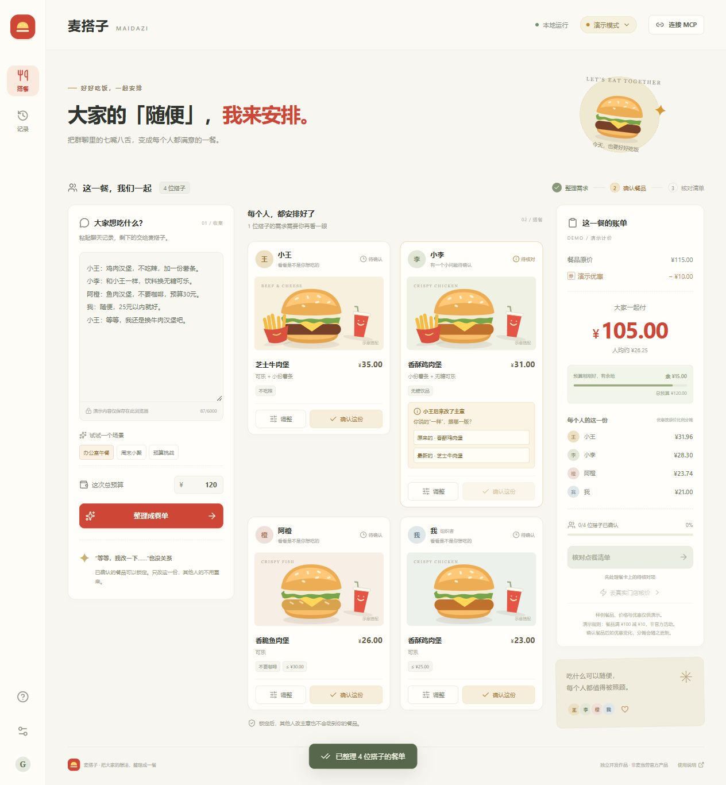

# 麦搭子 MaiDazi

**把群聊里的七嘴八舌，变成每个人都确认过的一餐。**

本地运行的多人点餐工作台：粘贴聊天 → 整理需求 → 解决跟单歧义 → 分人调整和锁定 → 核对账单与分摊 → 导出讨论清单。

这是独立开发作品，非麦当劳官方产品。当前版本 `0.1.0`。



## 适合谁用

帮同事收集午餐需求的组织者、宿舍或朋友聚餐的点餐负责人，以及希望在 MCP 客户端里整理多人需求的开发者。当前由一个组织者在本机操作，不需要其他人注册账号。

## 立即运行

Windows 上双击 **`启动麦搭子.cmd`**（或 `Start-MaiDazi.cmd`）。浏览器打开 <http://127.0.0.1:3210>。

- 需要 Node.js 22.12 或更高版本与 npm。
- 已安装依赖时不需要重新下载。首次缺少依赖时会执行 `npm ci`，需要联网。
- 双击 `Stop-MaiDazi.cmd` 停止由启动脚本管理的本地服务。
- 浏览器关闭后服务仍会运行；关闭启动窗口或按 Ctrl+C 可退出。服务只绑定 `127.0.0.1`。
- 启动信息显示在启动窗口，进程 ID 位于 `work/`；该目录被 Git 忽略。
- 若端口冲突，复制 `.env.example` 为 `.env`，修改 `PORT`。

命令行方式：

```sh
npm ci
npm run dev
# 或
npm run build
npm start
```

## 已实现的体验

- **聊天整理**：本地确定性规则识别 1—6 人、常见主食、饮品、小食、预算及常见偏好。每人一份主食，未知要求明确标记，不冒充通用 AI 理解。
- **跟单歧义**：小李说“和小王一样”，小王之后换了主食，会要求选择跟原版还是新版。
- **单人修改与锁定**：调整一位搭子不改变其他人的餐品；锁定后须先解锁才能编辑。支持撤销最近一次餐卡操作。
- **可解释账单**：用整数分计价。演示优惠满 100 减 10，按原价比例分摊，最大余数法分配尾差，保证分摊合计等于总额。
- **预算与偏好检查**：总预算不满足、个人餐品原价超过预算、已声明的简单偏好冲突、未识别行、未处理歧义，都会阻止最终清单确认。
- **导出与草稿**：全部确认后复制或下载文字清单；餐单草稿存于本浏览器 localStorage。使用指南中可清除。操作时间线只保留于本次页面会话。
- **原创界面与插画**：响应式中文界面、键盘操作、对话框焦点管理、减少动画偏好；无外部图片或字体依赖。

## 演示与真实数据的边界

| 能力                                    | 当前状态                                     |
| --------------------------------------- | -------------------------------------------- |
| 演示聊天解析、改餐、锁定、分摊、导出    | 可直接运行，已有自动化测试                   |
| 官方 MCP Streamable HTTP 接入、工具发现 | 已实现，需要个人 Token                       |
| 模型驱动的门店、菜单、优惠查询与核价    | 已实现接入流程和模拟测试，尚未用真实账号验证 |
| 官方响应展示                            | 原样显示核价数据和请求参数，不猜测金额单位   |
| 真实订单创建、支付、领券、积分消费      | 网页不支持；服务端白名单明确阻止             |
| 多人在线房间、分享链接同步、账号系统    | 未实现，当前由一个组织者操作                 |
| 全局最低价保证、自动过敏安全判断        | 不提供                                       |

演示商品名、插画、金额、优惠均为自制样例，不表示官方实时商品和价格。演示数据与真实查询分区展示，真实查询失败不会偷偷降级为假数据。

## 连接真实门店

1. 在 [麦当劳开放平台](https://open.mcd.cn/mcp) 申请个人 MCP Token。
2. 在网页右上角点击“连接 MCP”，填写 Token。
3. 填写支持 **Chat Completions 工具调用**的 OpenAI 兼容模型接口：Base URL、API Key、模型名称。Base URL 应含服务商要求的路径（通常 `/v1`），不要包含 `/chat/completions`。
4. 保存后点击“测试 MCP”验证工具发现；该按钮仅测试 MCP，不测试模型。
5. 处理餐卡上的待核对项后，点“去真实门店核价”，填写城市、地址或门店，提交查询。
6. 工具需要更多信息时，在补充信息中回答后重新查询。界面显示本次原始核价响应，核对业务状态、金额单位、商品和总价。

网页填入的凭据仅存服务进程内存，不写入浏览器存储或文件，重启清除。需要持久配置时，自行复制 `.env.example` 为 `.env` 并填写；`.env` 已加入忽略列表。

**数据流**：演示处理完全本地。主动发起真实查询时，选餐偏好、地点和相关工具结果会发送给你配置的模型服务，模型使用官方工具生成查询参数；可能产生模型费用。此版本面向个人本机使用，不要直接部署为公网多人服务。

## 45 秒演示脚本

1. 载入“办公室午餐”：小王改主意，小李的跟单出现待确认提示。
2. 选择小李跟原来的餐，再确认并锁定几位搭子的餐。
3. 只解锁小王，改餐并保存，观察总价与分摊变化，其他餐卡仍锁定。
4. 所有人确认后打开清单，复制或下载。
5. 切换“预算挑战”，展示超预算拦截。

这是演示建议，不是对真实服务响应时间的承诺。

## 项目结构

```text
src/                  React 页面、原创 SVG 插画、响应式样式
shared/planner.js     确定性解析、不可变餐单更新、预算检查与精确分摊
server/mcp.js         官方 SDK 客户端、工具发现与参数校验
server/agent.js       只读工具调用循环及核价凭据校验
server/app.js         本地 API、配置管理、来源校验、错误脱敏
skills/maidazi/       可交给支持 Skills 的客户端使用的工作流说明
tests/                Node.js 原生测试
scripts/              Windows 启动与停止脚本
MCP_INTEGRATION.md    接口、调用流程与验证边界
```

## 检查

```sh
npm test
npm run build
# 合并执行
npm run check
```

测试包括跟单歧义、锁定不可修改、局部更新不影响他人、优惠门槛变化、分摊分币守恒、预算拦截、错误输入、工具参数校验、写操作拒绝、核价凭据防伪、配置来源限制和密钥脱敏。模拟接口测试不等同于真实 MCP 验收。

## 参赛准备

已放入 README、原样下载的 `CONTEST_DECLARATION.md`、`MCP_INTEGRATION.md`、环境变量占位符形式的 `mcp-config.example.json` 与源代码。

**真实账号 MCP 调用验证尚未完成。** 接入代码、演示验证与真实调用证据在文档中分别说明；还需使用个人账号完成真实门店核价并补充脱敏证据。提交参赛申请不代表通过资格审核。未使用 WorkBuddy，不申请该专项奖励。

规则：[官方活动仓库](https://github.com/M-China/mcd-developer-innovation-challenge) · 接口：[官方 MCP 文档](https://github.com/M-China/mcd-mcp-server)

## 许可

本项目自有源代码与自制插画采用 [MIT License](LICENSE)。第三方依赖及官方文档分别适用各自的许可与使用条款；本项目许可不授予麦当劳商标或官方素材的使用权。
